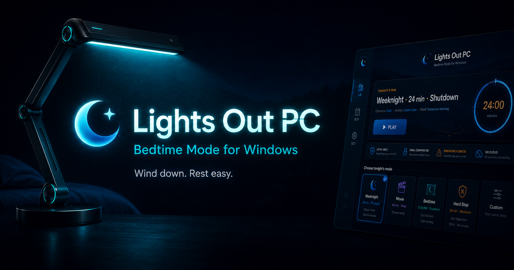
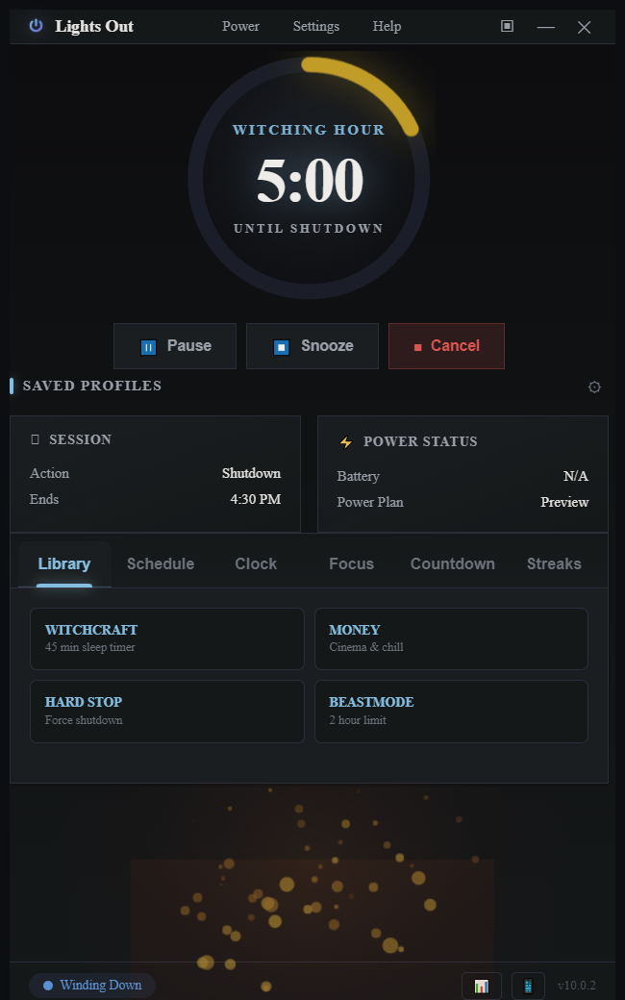

# Lights Out PC

**Bedtime Mode for Windows — a shutdown timer that gets out of your way until it matters.**
A [Proof Foundry](https://prooffoundry.com) product.

Set a time. Press START. Lights Out PC walks you through a calm wind-down, then a
cinematic Last Light final countdown before your PC shuts off. Emergency cancel
is always available. No surprise force-quits. No cloud account. No drama.

[](https://github.com/lazelife420-spec/Lights-out/releases/latest)
[](LICENSE)
[](https://theprooffoundry.com/lights-out/)

**Website:** [prooffoundry.com/lights-out](https://prooffoundry.com/lights-out/)

## Download

**[→ Lights Out releases — installer, portable ZIP, SHA256 checksums](https://github.com/lazelife420-spec/Lights-out/releases/latest)**

- `Lights Out Setup 11.2.0.exe` — NSIS installer, standard Windows install
- `Lights-Out-Portable-v11.2.0-win-x64.zip` — extract, then run `Lights Out.exe`; no install needed
- `SHA256SUMS.txt` — checksums for both artifacts



### Why I built it

I got tired of shutting down my PC the hard way. `shutdown /s /t 3600` works
until you typo it and your screen goes black mid-project. Task Scheduler is fine
but feels like doing taxes at bedtime. I wanted something that felt like closing
a book, not launching a missile.

Lights Out opens idle. No auto-start countdown. You pick a time, press START,
and the app walks you through a wind-down. The Last Light cinematic final
countdown runs, then the machine shuts down. Emergency cancel is always one
keystroke away (`Ctrl+Shift+S`).

### Free. Local. No account.

- **No account.** Nothing to sign up for.
- **No subscription.** The whole app is free.
- **No ads. No telemetry.** Your data stays on your machine.
- **No cloud.** Receipts and settings live in `AppData`, never a server.

One outbound connection by default: a periodic check against the GitHub Releases
API for a newer version. No personal data. No usage analytics. Smart-light,
calendar, and Wi-Fi features only reach out when you configure them.

### Standalone phone app

The [Android app](companion-android/README.md) has its own offline reminder timer,
with the countdown ring, optional analog clock, and native background alerts.
Use **PC controls** to pair with a desktop and control its timer and routines over
the same Wi-Fi. Phone and PC timers stay independent; the phone works with the PC
off. PC power actions and PC-connected lighting routines require a running PC.

### Proof-backed releases

Release artifacts include an installer, portable ZIP, SHA256SUMS.txt and a
BUILD-MANIFEST.json with the source commit and runtime hashes. The v11.2.0
pipeline requires desktop tests, isolated Android debug qualification, Windows
runtime checks and installer/portable verification before publication. Source on
main alone does not establish that a release is published.

- Latest release: https://github.com/lazelife420-spec/Lights-out/releases/latest
- v11.2.0 release target: https://github.com/lazelife420-spec/Lights-out/releases/tag/v11.2.0
- Smoke suite: 299 checks

## Surface

The app is a single Electron edition under **`electron/`** - a cockpit-style
dashboard. (A legacy PowerShell / WinForms "classic" app was removed on
2026-06-29; PowerShell is now invoked only as system calls from the Electron
main process, not as a separate app.) See [`AGENTS.md`](AGENTS.md) for the full
contributor handoff.

## Features

- Countdown to shutdown, restart, sleep, hibernate, or log out.
- Start, pause, resume, snooze, cancel, mini mode, tray, and taskbar progress.
- **Night Modes Library** — arm Quick Sleep, Lights Down, Movie Wind-Down, or
  Full Shutdown from declarative cards; selecting a mode never auto-starts.
- **Nightly tray utility** - sit in the tray and show the current time while idle
  (Clock Mode), start common timers (28 min / 1 hour) and pause / resume / snooze /
  cancel straight from the tray, with the live countdown kept in the tray tooltip.
- **Countdown ring and optional analog clock** - the countdown ring is the default.
  Choose Analog clock beneath the idle dial or in Settings > Appearance; your
  choice is remembered. Active timers always show time remaining, with a clear
  end time or paused label. Clock size, 12/24-hour format, analog styles, hand
  color, and an optional second hand remain customizable.
- **Wind-down phase** - ambient visuals (fireplace, rain, starfield, aurora),
  warm color shift, and optional Night Light / media pause.
- **Stateful settings** - everything persists to `userData\settings.json` and is
  restored on launch.
- **Customization console** - accent color, theme (Midnight / Carbon / Aurora),
  ring style, window opacity, and sound volume, applied live.
- **Smart Lights** - WiZ Wi-Fi lights, Philips Hue, or HTTP webhook (gradual dim,
  warm shift, off-at-end). WiZ discovery and connection verification read status;
  automatic lighting stays off until enabled. Select individual WiZ lights or
  locally named room groups, and choose brightness, white temperature, custom
  color, or a WiZ preset in Settings → Lighting. Discovery keeps your selection.
  A chosen look applies to already-on lights when dimming begins; Keep current
  uses their existing brightness. Warm Shift uses warm white. Send test action
  explicitly turns selected lights on using the chosen brightness and look.
  Switching a light off in WiZ releases it for the rest of the wind-down,
  including cancellation. Unreachable lights are skipped until they answer.
  Morning sunrise also yields to a manual off after its initial wake action.
  Cancelling restores the pre-dim state only for lights changed by the dimmer
  that are still under its control.
- **Saved profiles** - save the current timer as a profile in one click, schedule
  by duration or a specific date/time, and right-click a profile to Start, Edit, or
  Delete it. The calendar supports weekly rules, monthly dates (including the last
  day), individual dates, and selected months, with saved routines and timers.
  Imported calendars (.ics and connected providers) remain available.
- **Settings control room** - browse dedicated categories, use Ctrl+K or / to
  search, and use arrow keys to move between categories. Compact
  navigation fits the minimum window; Save and Cancel remain visible. Failed
  saves leave the form open with your edits intact. WiZ setup groups light
  selection and appearance into separate blocks.
  Unsaved changes stay visible. Subtle hidden star signatures follow the
  Lights Out style and respect reduced motion. Guided breathing has been removed.
- **Phone Companion Easy Connect** - control Lights Out from your phone on the same
  Wi-Fi via a simple QR scan + pairing code. Off by default, token-protected, and never
  exposes LAN access in "This PC only" mode.
- **Last Light finale** - a cinematic timer-zero sequence with countdown ring,
  atmospheric panels, and UNPLUG visual (v10.3.0 northstar design). Power action
  fires automatically; emergency cancel (`Ctrl+Shift+S`) is always available.
- **Morning Proof hero** - after a completed session, a full-width card shows
  real stats: session length, action, snooze count, total runs. No fake data.
- **Imminent-action warning** - a grace-period dialog with Snooze / Cancel.
- **Crash recovery** - an interrupted countdown offers Resume / Dismiss on restart.



## Why it is safe by default

- Opens idle, never as an instant countdown.
- Force shutdown is an explicit, opt-in action (Settings), never the default.
- "Run at login" means start minimized and idle, nothing more.
- **System actions are opt-in.** Night Light, media pause, and window lockout
  during wind-down are all OFF by default. The app never touches your OS unless
  you explicitly enable it.


## Run the Electron app

```powershell
cd electron
npm install   # first time only
npm start
```

## Build a Windows package

```powershell
cd electron
npm run build   # installer, portable ZIP and checksums in ../dist-native
```

## Develop & verify

```powershell
cd electron
npm run icons   # regenerate app icon/logo from assets/*.svg
npm run smoke   # syntax, settings round-trips, startup/tray guards, UI wiring, preview-safe defaults
```

CI (`.github/workflows/ci.yml`) runs lint + smoke on Linux and packages on Windows
for every push.

## License

[MIT](LICENSE) © 2026 Proof Foundry. Free to use, modify, and distribute.

---

<sub>Lights Out™ — a [Proof Foundry](https://prooffoundry.com) product. Built for Windows 10/11.</sub>
