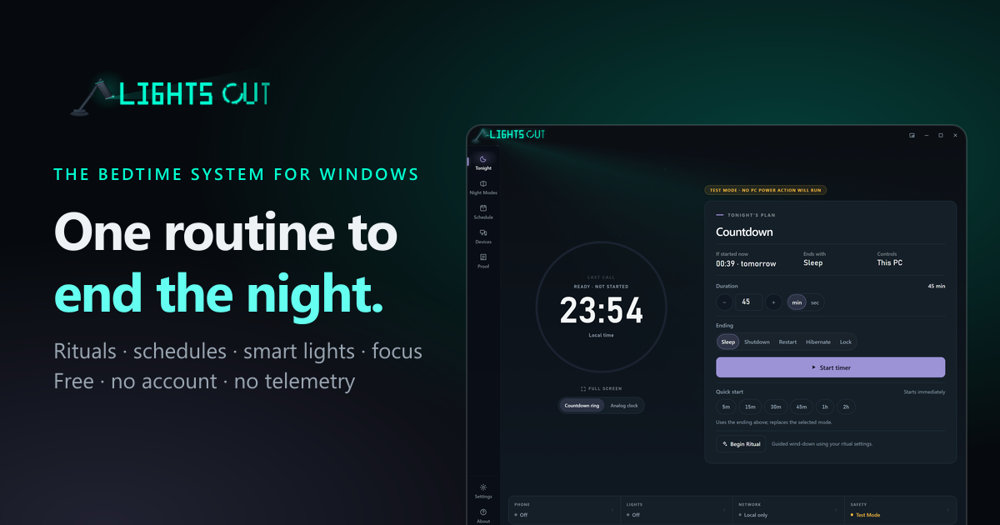
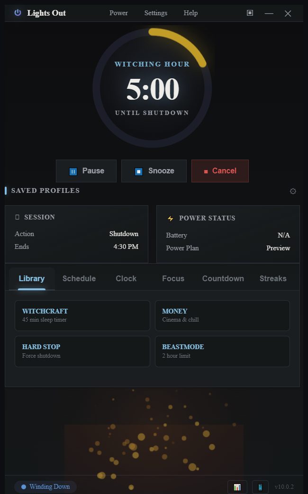

# Lights Out

**The bedtime system for Windows. One routine to end the night.**
Forged by [The Proof Foundry](https://theprooffoundry.com).

Set a time. Press START. Lights Out walks you through a calm wind-down, then
(if you turn it on) a cinematic Last Light finale before your PC shuts off. You
can cancel right up until the power request is sent to Windows. No surprise force-quits.
No cloud account. No drama.

[](https://github.com/lazelife420-spec/Lights-out/releases/latest)
[](LICENSE)
[](https://theprooffoundry.com/lights-out/)

**Website:** [theprooffoundry.com/lights-out](https://theprooffoundry.com/lights-out/)

## Download

**[→ Lights Out releases — installer, portable ZIP, SHA256 checksums](https://github.com/lazelife420-spec/Lights-out/releases/latest)**

- `Lights-Out-Setup-v11.3.2.exe` — NSIS installer, standard Windows install
- `Lights-Out-Portable-v11.3.2-win-x64.zip` — extract, then run `Lights Out.exe`; no install needed
- `SHA256SUMS.txt` — checksums for both artifacts



### Why I built it

I got tired of shutting down my PC the hard way. `shutdown /s /t 3600` works
until you typo it and your screen goes black mid-project. Task Scheduler is fine
but feels like doing taxes at bedtime. I wanted something that felt like closing
a book, not launching a missile.

Lights Out opens idle. No auto-start countdown. You pick a time, press START,
and the app walks you through a wind-down. If you turned on Last Light, its
cinematic finale runs; then the machine shuts down. Emergency cancel is one keystroke
away: `Ctrl+Shift+X` from anywhere. `Esc` also cancels a running or paused
countdown while the Lights Out window has focus, but it closes an open dialog
or panel first (or leaves a focused field): at the imminent-action warning, `Esc` only closes the warning
and the countdown keeps going, so use its **Cancel timer** button or
`Ctrl+Shift+X`. `Ctrl+Shift+S` only shows or hides the window; it does not
cancel.

### Free. Local. No account.

- **No account.** Nothing to sign up for.
- **No subscription.** The whole app is free.
- **No ads. No telemetry.** Your data stays on your machine.
- **No cloud.** Receipts and settings live in `AppData`, never a server.

The one automatic outbound connection is the update check: an HTTPS request for
The Proof Foundry's public release record
(`https://theprooffoundry.com/truth/products/lights-out.json`) when the app starts
and every 4 hours while it runs. There is no setting to turn it off, and there is
no GitHub or other fallback source. If a newer version is listed, the
SHA-256-verified portable ZIP is downloaded from `downloads.theprooffoundry.com`
only when you click **Download**. No personal data. No usage analytics.
Smart-light, calendar, webhook and Wi-Fi Guard features only reach out when you
configure them.

### Standalone phone app

The [Android app](companion-android/README.md) has its own offline reminder timer,
with the countdown ring, optional analog clock, and native background alerts.
Use **Pair PC** (then **Open PC controls**) to pair with a desktop and control its
timer and routines over the same Wi-Fi. Phone and PC timers stay independent; the phone works with the PC
off. PC power actions and PC-connected lighting routines require a running PC.

### Proof-backed releases

Release artifacts include an installer, portable ZIP, SHA256SUMS.txt and a
BUILD-MANIFEST.json with the source commit and runtime hashes. The release
pipeline requires desktop tests, isolated Android debug qualification, Windows
runtime checks and installer/portable verification before publication. Source on
main alone does not establish that a release is published.

- Latest release: https://github.com/lazelife420-spec/Lights-out/releases/latest
- v11.3.2 release target: https://github.com/lazelife420-spec/Lights-out/releases/tag/v11.3.2
  ([release notes](docs/RELEASE_NOTES_11.3.2.md), [qualification record](docs/RELEASE_QUALIFICATION_11.3.2.md)).
- v11.3.1: https://github.com/lazelife420-spec/Lights-out/releases/tag/v11.3.1
  ([release notes](docs/RELEASE_NOTES_11.3.1.md), [qualification record](docs/RELEASE_QUALIFICATION_11.3.1.md)).
- v11.3.0: https://github.com/lazelife420-spec/Lights-out/releases/tag/v11.3.0
  ([release notes](docs/RELEASE_NOTES_11.3.0.md), [qualification record](docs/RELEASE_QUALIFICATION_11.3.0.md)).
- v11.2.0 qualification: 1,046 unit tests and 299 smoke checks, recorded in
  [docs/RELEASE_QUALIFICATION_11.2.0.md](docs/RELEASE_QUALIFICATION_11.2.0.md).
  Suite sizes change between releases; `npm test` and `npm run smoke` print the
  current totals.

## Surface

Lights Out is a single Windows desktop app, built with Electron, under
**`electron/`**: a cockpit-style dashboard. (A legacy PowerShell / WinForms
"classic" app was removed on 2026-06-29; PowerShell is now invoked only as
system calls from the Electron main process, not as a separate app.) See
[`AGENTS.md`](AGENTS.md) for the full contributor handoff.

## Features

- Countdown to shutdown, restart, sleep, hibernate, lock, or log out. Shutdown,
  restart and log out use Windows' `shutdown.exe`; lock uses
  `LockWorkStation`. Sleep and Hibernate go through
  a bundled helper (`native/WindowsSuspend.exe`) that asks Windows first: if this
  PC does not offer the state, nothing runs and the receipt says **blocked**.
  Hibernate needs hibernation turned on in Windows (a full hibernation file);
  Lights Out never switches a blocked Hibernate to Sleep or Shutdown.
- Start, pause, resume, snooze, cancel, mini mode, tray, and taskbar progress.
  While a run is active the taskbar button carries a badge (amber for Test
  Mode, rose for a real action) and its thumbnail offers Pause/Resume, Snooze
  and Cancel.
- **Keyboard shortcuts** - `Ctrl+Shift+X` cancels from anywhere, including during
  Last Light and the final steps before the power request is sent to Windows
  (the tray menu offers the same cancel). `Ctrl+Shift+Space` pauses or resumes,
  `Ctrl+Shift+Z` snoozes 5 minutes, `Ctrl+Shift+S` shows or hides the window,
  `Ctrl+Shift+W` toggles the desktop widget and `Ctrl+Shift+P` previews Last
  Light. The global quick-start hotkeys
  (`Ctrl+Shift+L` for 15 min, `Ctrl+Shift+1`-`4` for 30/45/60/90 min) are **off
  by default**, because they start a real timer from inside other apps and
  collide with shortcuts in Excel and elsewhere. To turn them on, quit Lights
  Out first (tray › **Quit**; the app rewrites `settings.json` while it runs,
  so an edit made while it is open is lost), then set
  `"globalQuickStartShortcuts": true` in the `app` section of
  `userData\settings.json` (installed: `%APPDATA%\lights-out-electron\settings.json`;
  portable: `<extracted folder>\user-data\settings.json`), then start Lights Out
  again.
- **Backups** - **Export all data** (Night Modes › My Modes › Manage) saves settings,
  streaks and modes to a JSON file. It leaves out router, webhook, calendar and
  Hue credentials, the phone pairing code and any running timer. **Import all
  data** keeps this PC's own credentials and pairing code, and never restores
  or starts a timer.
- **Night Modes Library** — arm Quick Sleep, Lights Down, Movie Wind-Down, or
  Full Shutdown from declarative cards; selecting a mode never auto-starts.
- **Nightly tray utility** - sit in the tray and show the current time while idle
  (Clock Mode), start common timers (28 min / 1 hour) and pause / resume / snooze /
  cancel straight from the tray, with the live countdown kept in the tray tooltip.
- **Countdown ring and optional analog clock** - the countdown ring is the default.
  Choose Analog clock beneath the idle dial or in Settings > Appearance; your
  choice is remembered. Active timers always show time remaining, with a clear
  end time or paused label. Clock size, 12/24-hour format, analog styles, hand
  color, and an optional second hand remain customizable.
- **Wind-down phase** - ambient visuals (fireplace, rain, starfield, aurora),
  warm color shift, and optional Night Light / media pause.
- **Stateful settings** - everything persists to `userData\settings.json` and is
  restored on launch.
- **Customization console** - accent color, theme (Midnight / Carbon / Aurora /
  Ember / Tide / Dawn), ring style, window opacity, and sound volume, applied
  live.
- **Smart Lights** - WiZ Wi-Fi lights, Philips Hue, or HTTP webhook (gradual dim,
  warm shift, off-at-end). WiZ discovery and connection verification read status;
  automatic lighting stays off until enabled. Select individual WiZ lights or
  locally named room groups, and choose brightness, white temperature, custom
  color, or a WiZ preset in Settings → Lighting. Discovery keeps your selection.
  A chosen look applies to already-on lights when dimming begins; Keep current
  uses their existing brightness. Warm Shift uses warm white. Send test action
  explicitly turns selected lights on using the chosen brightness and look.
  Switching a light off in WiZ releases it for the rest of the wind-down,
  including cancellation. Unreachable lights are skipped until they answer.
  Morning sunrise also yields to a manual off after its initial wake action.
  Cancelling restores the pre-dim state only for lights changed by the dimmer
  that are still under its control.
- **Saved profiles** - save the current timer as a profile in one click, schedule
  by duration or a specific date/time, and right-click a profile to Start, Edit, or
  Delete it. The calendar supports weekly rules, monthly dates (including the last
  day), individual dates, and selected months, with saved routines and timers.
  Imported calendars (.ics and connected providers) remain available.
- **Settings control room** - browse dedicated categories, use Ctrl+K or / to
  search, and use arrow keys to move between categories. Compact
  navigation fits the minimum window; Save and Cancel remain visible. Failed
  saves leave the form open with your edits intact. WiZ setup groups light
  selection and appearance into separate blocks.
  Unsaved changes stay visible. Subtle hidden star signatures follow the
  Lights Out style and respect reduced motion. Guided breathing has been removed.
- **Phone Companion Easy Connect** - control Lights Out from your phone on the same
  Wi-Fi via a simple QR scan + pairing code. Off by default, token-protected, and never
  exposes LAN access in "This PC only" mode. The phone can start, pause, snooze or
  cancel, but never force a shutdown, log out or hibernate; a Night Mode started
  from the phone can only end with Shutdown, Sleep or Restart.
- **Last Light finale** - a cinematic timer-zero sequence with countdown ring,
  atmospheric panels, and UNPLUG visual (v10.3.0 northstar design). The power
  action follows automatically. `Ctrl+Shift+X` or the tray's cancel still stops
  it until the power request is sent to Windows; after that it cannot be
  recalled.
- **Morning Proof hero** - after a run, a full-width card shows what the receipt
  recorded: run length, action, snoozes, start and end times. It says plainly
  when the Windows outcome could not be verified. No fake data.
- **Streaks** - a night counts when a non-Test timer reaches zero or you log
  an emergency override (override nights are recorded as snoozed nights). Test Mode
  runs, cancelled runs and countdowns the PC slept through before zero do not
  count. Streaks do not verify that Windows powered off and do not measure
  sleep.
- **Wi-Fi Guard (experimental, off by default)** - at wind-down it can block
  chosen devices through a supported router or your webhook, or turn off this
  PC's Wi-Fi adapter. A finished run always asks for the block to be undone,
  and so does a cancel unless you turned off **Restore on cancel**.
  Before any network change it saves a credential-free recovery record
  (provider and adapter ID) in `userData\wifi-guard-recovery.json`; if that
  record cannot be saved, nothing is blocked. Quitting Lights Out tries to undo
  a block first (up to 8 seconds). The next launch tries to undo a block that a
  crash or forced quit left behind and tells you if it cannot; a block you
  chose to keep stays, and the app says so. This
  recovery is covered by unit tests only; real router and adapter behaviour is
  not qualified, and a provider's acknowledgement does not prove the internet
  is back.
- **Imminent-action warning** - a grace-period dialog with Snooze / Cancel.
- **Crash recovery** - an interrupted countdown offers Resume / Dismiss on restart.



## Why it is safe by default

- Opens idle, never as an instant countdown.
- Force shutdown is an explicit, opt-in action (Settings), never the default.
- "Run at login" means start minimized and idle, nothing more.
- **System actions are opt-in.** Night Light, media pause, and window lockout
  during wind-down are all OFF by default. The app never touches your OS unless
  you explicitly enable it.
- **Test Mode is a full rehearsal.** It runs the countdown and ritual but skips
  the power action and every automatic effect: smart lights, Night Light,
  closing apps, media pause, Wi-Fi Guard, the Content Blocker, window lockout
  and accountability-partner messages. Manual device controls stay live.
- **Media pause only pauses what is playing.** It asks Windows whether the
  current media session is playing before sending the play/pause key, so the
  pause never starts paused media, and it reports only a player that actually
  stopped. If you cancel, it resumes only the same app, and only while
  Windows still reports its current session paused: music you started again,
  or another app's paused video, gets no key. A browser counts as one app,
  whichever tab is current. A run that ends without a cancel never restarts
  it.
- **A deadline slept through by more than 5 minutes never fires.** If the PC
  sleeps or hibernates through a real countdown's end and wakes more than 5
  minutes late, the run ends as **missed** with a notification and no power
  action is requested.
- **Unclear checks block the power action.** Before a real power request,
  Lights Out looks for open "Save changes?" dialogs and waits 10 seconds if it
  finds one. If that check fails or takes longer than 15 seconds, or Wi-Fi
  Guard cannot confirm it undid its block, the action is blocked and recorded
  on the receipt instead of being sent.


## Run the Electron app

```powershell
cd electron
npm ci                     # first time only
npm run electron:provision # download locked Electron binary
npm start
```

## Build a Windows package

```powershell
cd electron
npm run build   # installer, portable ZIP and checksums in ../dist-native
```

## Develop & verify

```powershell
cd electron
npm run icons   # regenerate app icon/logo/tray PNGs from assets/brand/*.svg
npm run smoke   # syntax, settings round-trips, startup/tray guards, UI wiring, preview-safe defaults
```

CI (`.github/workflows/ci.yml`) runs lint + smoke on Linux and packages on Windows
for every push.

## License

[MIT](LICENSE) © 2026 The Proof Foundry. Free to use, modify, and distribute.

---

<sub>Lights Out™ — the bedtime system for Windows. Forged by [The Proof Foundry](https://theprooffoundry.com). Built for Windows 10/11.</sub>
