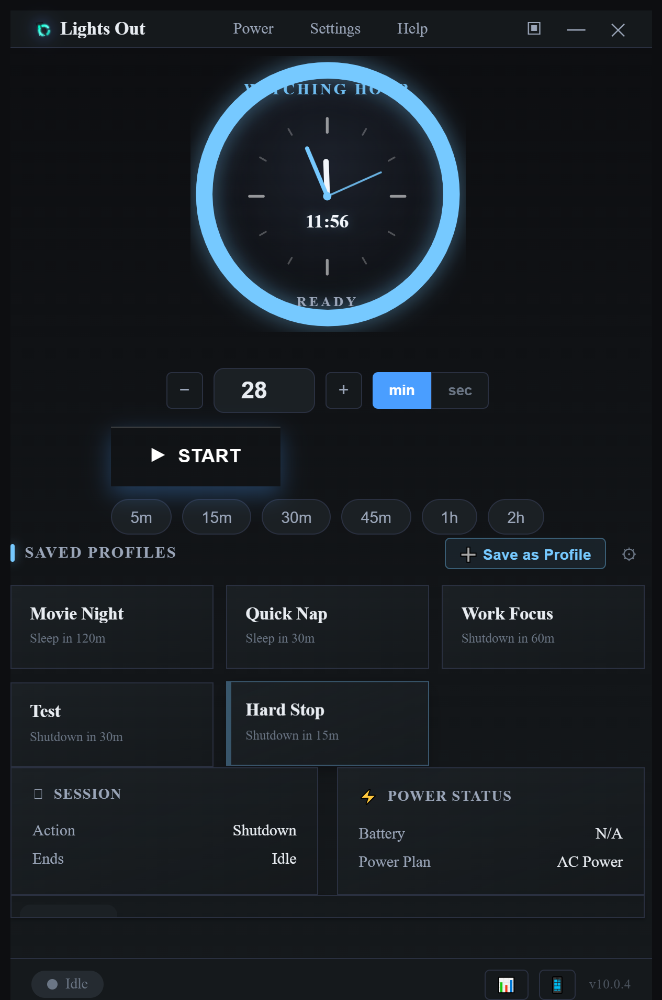

# Lights Out PC — Bedtime Mode for Windows

I built a Windows bedtime control app I would actually use every night.
It starts with the PC and is designed to grow into a whole-room bedtime control system.

Windows commands work, but they are annoying.
Old shutdown timer apps work, but most feel clunky.

Lights Out is free:
No account.
No subscription.
No ads.

Installer, portable build, SHA256 checksums, and proof-backed releases are all public.

**Download:** https://github.com/lazelife420-spec/Lights-out/releases/latest

## What it does

- **Nightly tray utility.** It sits in your tray and shows the current time while
  idle (Clock Mode) - pick a digital, analog, or hybrid clock face and recolor the
  hands. Start common timers (28 min / 1 hour), or pause / resume / snooze / cancel
  straight from the tray. The live countdown stays in the tray tooltip.
- **Countdown to shutdown, restart, sleep, hibernate, or log out.**
- **Phone Companion Easy Connect** — control the timer from your phone on the
  same Wi-Fi via QR scan + pairing code. Off by default, token-protected, and
  never forces a shutdown, log out, or hibernate.
- **Wind-down phase** with ambient visuals (fireplace, rain, starfield, aurora),
  a warm color shift, and optional Night Light / media pause.
- **Saved profiles, calendar scheduling (.ics), and a Last Light finale** for
  the people who want the full ritual. Optional **LuxGrid RGB event integration**
  can react to Lights Out events, but that is not native smart-light control.

## Safe by default

- Opens idle, never as an instant countdown.
- Force shutdown is an explicit, clearly named action - never the default, never
  hidden in the tray.
- "Run at login" means start minimized and idle, nothing more.
- System actions (Night Light, media pause, window lockout during wind-down) are
  all OFF by default. The app never touches your OS unless you turn them on.

## Planned: whole-room bedtime control

The long-term idea is a bedtime automation scheduler where each part of the
night environment can have its own action and schedule:

- **PC** — shut down / sleep / hibernate / lock at a set time.
- **Bedroom lights** — dim or turn off at a chosen time.
- **Other lights** — off at different times.
- **Wi-Fi/router** — disable or change state at a chosen time.
- **Phone companion** — view everything, change times, add time, cancel actions.
- **Dates and recurrence** — tonight only, specific date, weekdays, weekends,
  selected days.
- **Presets/Rituals** — save the whole collection as Weeknight, Movie Night,
  Weekend, etc.

This is not implemented in the current release. The current app controls the PC
and supports the phone companion; smart-light and Wi-Fi/router orchestration
are future directions.

## Proof-backed releases

Every release ships an installer, a portable EXE, and a `SHA256SUMS.txt` so you can
verify exactly what you downloaded. Builds are produced and published by CI, and
each release is gated on `node --check`, a smoke suite, and a successful package
step.

**Latest: v11.1.0** - adds the Night Modes Library with four ready,
main-resolved bedtime presets, safe lobby arming, canonical receipt identity,
and real Electron Dry Run proof. Smoke suite at 239 assertions.
Release notes: https://github.com/lazelife420-spec/Lights-out/releases/tag/v11.1.0

Previously, v10.0.9 restored the Streaks tab panel and fixed a cancel-timer error where guided breathing cleanup could show a red error toast.

Previously, v10.0.7 fixed clock preference restoration on app launch and
prevented saved clock settings from being overwritten by startup defaults;
v10.0.6 added a smooth sweeping second hand, a new Classic (Roman)
watch face, Hybrid as the default clock, and a fix for a startup crash when a
companion port was already in use; v10.0.5 brought a crisp small-size app icon
and an About dialog with the brand wordmark; v10.0.4 added customizable clock
faces (digital / analog / hybrid), the desk-lamp logo, and right-click menus on
profiles and the clock.

---

### Short version (for social / forum posts)

> Lights Out PC - a free Windows bedtime control app that starts with the PC.
> Set a timer, control it from your phone on the same Wi-Fi, wind down with
> ambient visuals, and never force-shut-down unless you ask it to.
> No account, no ads. Installer + portable + SHA256 checksums, all public.
> https://github.com/lazelife420-spec/Lights-out/releases/latest
