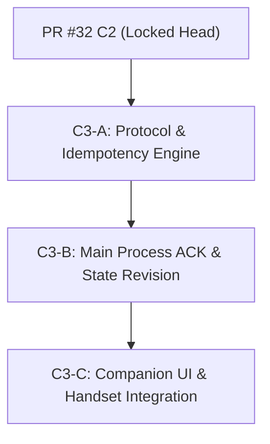

# Companion V2 C3 — Request IDs, Authoritative Acknowledgements, and Idempotency Audit & Plan

**Repository:** `C:\Users\KickA\Desktop\Lights Out`  
**Base Head:** `ffff1302e6df46fd32f33013405737765b334c85` (Locked PR #32 C2)  
**Branch:** `audit/companion-v2-c3-request-acks`  
**Status:** Architecture Audit & Specification Document (Read-Only Planning)

---

## 1. Scope & Purpose

This document provides a comprehensive architecture audit of the current Lights Out companion control plane and defines the exact protocol contract, idempotency semantics, acknowledgement lifecycle, and UI state machine for **Companion V2 C3 (Request IDs, Authoritative Acknowledgements, and Idempotency)**.

The primary objective of C3 is to elevate companion remote control from indirect state-polling locks to **authoritative server-side deduplication and targeted command acknowledgements**.

---

## 2. Current Command Path Audit

### End-to-End Command Trace

Every companion interaction currently follows this workflow:

```text
User Physical Gesture (Tap / Key)
  │
  ▼
companion.html UI Handler (validates local stateIsAuthoritative())
  │
  ▼
ws.send(JSON.stringify({ action: ... }))  [Client WebSocket]
  │
  ▼
TCP Transport (LAN Wi-Fi)
  │
  ▼
companion.js consumeFrames()  [RFC 6455 Frame Reader & Unmasking]
  │
  ▼
remoteControl.validateCompanionMessage()  [Action & Range Sanitization]
  │
  ▼
companion.js EventEmitter ('message' event)
  │
  ▼
main.js handleCompanionMessage()  [Main Process Handler]
  │
  ▼
startTimer() / pauseTimer() / resumeTimer() / cancelTimer()  [State Mutation]
  │
  ▼
broadcastCompanionState()  [Desktop State Broadcast (type: 'state')]
  │
  ▼
companion.html handleUpdate() / confirmPendingFromState()  [Client State Match]
```

### Supported Companion Messages & Classification

| Action / Message | Category | Description / Parameters | Current Desktop Effect |
| :--- | :--- | :--- | :--- |
| `getNightModes` | Read-Only Query | `{ action: 'getNightModes' }` | Returns `type: 'nightModes'` with catalogue modes. |
| `start` | Mutating Command | `{ action: 'start', durationSeconds, timerAction }` | Starts standard timer with specified duration and action. |
| `startNightMode` | Mutating Command | `{ action: 'startNightMode', nightModeId }` | Resolves canonical mode in main process and starts timer. |
| `togglePause` | Mutating Command | `{ action: 'togglePause' }` | Toggles paused/running state of active timer. |
| `snooze` | Mutating Command | `{ action: 'snooze', seconds }` | Adds seconds to active timer. |
| `cancel` | Mutating Command | `{ action: 'cancel' }` | Stops active timer/ritual back to IDLE. |
| `type: 'state'` | Server-to-Client | Broadcast from main process | Delivers full timer, profile, system, and stats projection. |
| `type: 'nightModes'` | Server-to-Client | Targeted response from main process | Delivers Night Mode catalogue array. |
| Local UI Toggles | Local UI-Only | Accordion, modal open/close, action segment | Updates DOM view state without WS transmission. |

### Duplicate Execution Vulnerabilities in Current Codebase

1. **Network Retries & Packet Duplication:** If a TCP retransmission, Wi-Fi packet duplicate, or client browser retry occurs during network jitter, the desktop server receives multiple identical JSON frames. `handleCompanionMessage()` processes every valid frame independently:
   - Duplicate `snooze(900)` frames increase timer by $+1800\text{s}$ ($+30\text{m}$) instead of $+15\text{m}$.
   - Rapid double-taps on preset start buttons dispatch duplicate start requests before UI state updates.
2. **Client-Side Pending Locks vs. Server Idempotency:** C1 introduced `pendingOperation` in `companion.html` to disable buttons while waiting for a matching state broadcast. However, client-side UI locking:
   - Cannot prevent rapid gestures occurring within the same event loop frame.
   - Provides zero protection against network-level frame replays or proxy duplicates.
   - Provides zero protection across multiple paired devices tapping concurrently.
   - The desktop main process currently retains **no record of past commands** and executes all incoming frames blindly.

---

## 3. Request-ID Contract Specification

### Additive Schema

C3 introduces a mandatory `requestId` property for all mutating companion commands, preserving backward-compatible JSON object structures.

#### Example Mutating Command:
```json
{
  "action": "snooze",
  "requestId": "9b1deb4d-3b7d-414d-9076-24a919379899",
  "seconds": 900
}
```

### Request-ID Constraints & Sanitization
- **Allowed Character Set:** Alphanumeric characters `[a-zA-Z0-9]`, hyphen `-`, and underscore `_`.
- **Length Bounds:** Minimum 16 characters, maximum 64 characters.
- **Format Validation Regex:** `/^[a-zA-Z0-9_-]{16,64}$/`
- **Validation Function:** Integrated directly into `remoteControl.validateCompanionMessage()`.
- **Malformed Handling:** Any mutating command with a missing, non-string, or invalid `requestId` is rejected with `invalid_request_id`.

### Generation Mechanism
Client generation uses standard UUID v4:
```javascript
function generateRequestId() {
  if (typeof crypto !== 'undefined' && typeof crypto.randomUUID === 'function') {
    return crypto.randomUUID();
  }
  // Fallback for older WebView contexts
  const bytes = new Uint8Array(16);
  crypto.getRandomValues(bytes);
  bytes[6] = (bytes[6] & 0x0f) | 0x40; // Version 4
  bytes[8] = (bytes[8] & 0x3f) | 0x80; // Variant 10xx
  const hex = Array.from(bytes, b => b.toString(16).padStart(2, '0')).join('');
  return `${hex.slice(0,8)}-${hex.slice(8,12)}-${hex.slice(12,16)}-${hex.slice(16,20)}-${hex.slice(20)}`;
}
```

### Application Scope & Query Rules
- **Mutating Commands:** `requestId` is mandatory (`start`, `startNightMode`, `togglePause`, `snooze`, `cancel`).
- **Read-Only Queries:** `getNightModes` may optionally include a `requestId` as a correlation token. If provided, the server echoes `requestId` in the `type: 'nightModes'` payload.

---

## 4. Acknowledgement Semantics

### Targeted `commandAck` Protocol Frame

Instead of relying solely on indirect timer state broadcasts, the server immediately emits a targeted `commandAck` frame to the client socket that submitted the request.

```json
{
  "type": "commandAck",
  "requestId": "9b1deb4d-3b7d-414d-9076-24a919379899",
  "action": "snooze",
  "status": "applied",
  "reason": null,
  "stateRevision": 42,
  "duplicate": false
}
```

### Status Lifecycle Definitions

| Status | Meaning | Client UI Behavior |
| :--- | :--- | :--- |
| `accepted` | Schema valid, token valid, `requestId` registered in server pipeline. Processing initiated. | UI maintains `pending` state (`Waiting for PC…`). |
| `applied` | Authoritative desktop state transition occurred. `stateRevision` updated. | UI resolves `pending` to success, plays feedback toast, unlocks controls. |
| `rejected` | Command execution blocked by policy or main process guard. Contains `reason`. | UI resolves `pending` to error, displays specific reason, unlocks controls. |
| `duplicate` | Request ID was previously processed. Server re-emits cached `commandAck` with `duplicate: true`. | UI resolves `pending` without re-executing desktop action. |

---

## 5. Stable Rejection Reason Enum

To prevent leaking desktop paths, stack traces, or internal object structures, C3 defines a strict, bounded enum of machine-readable error codes:

```javascript
const REJECTION_REASONS = {
  INVALID_REQUEST_ID: 'invalid_request_id',
  REQUEST_ID_CONFLICT: 'request_id_conflict',
  INVALID_PAYLOAD: 'invalid_payload',
  UNSUPPORTED_ACTION: 'unsupported_action',
  NOT_AUTHENTICATED: 'not_authenticated',
  NOT_IDLE: 'not_idle',
  NO_ACTIVE_TIMER: 'no_active_timer',
  ALREADY_PAUSED: 'already_paused',
  ALREADY_RUNNING: 'already_running',
  MODE_UNKNOWN: 'mode_unknown',
  MODE_UNAVAILABLE: 'mode_unavailable',
  RITUAL_ACTIVE: 'ritual_active',
  STALE_STATE: 'stale_state',
  INTERNAL_ERROR: 'internal_error'
};
```

---

## 6. Server-Side Idempotency Engine

### In-Memory Registry Architecture

The desktop main process maintains an in-memory idempotency registry:

```javascript
// Map<string, IdempotencyRecord>
// Key format: `${clientTokenHash}:${requestId}`
```

#### Record Schema:
```javascript
{
  requestId: '9b1deb4d-3b7d-414d-9076-24a919379899',
  action: 'snooze',
  payloadHash: 'a591a6d40bf420404a011733cfb7b190d62c65bf0bcda32b57b277d9ad9f146e',
  status: 'applied', // 'in_progress' | 'applied' | 'rejected'
  terminalAck: { ... }, // Cached commandAck DTO
  createdAt: 1784343000000,
  expiresAt: 1784343600000
}
```

### Rules & Edge Behavior

1. **Same `requestId`, Same Payload Hash:**
   - Server returns cached `terminalAck` with `"duplicate": true`.
   - Desktop timer/ritual state is NOT mutated again.
2. **Same `requestId`, Different Action or Payload Hash:**
   - Server rejects request with `status: 'rejected'`, `reason: 'request_id_conflict'`.
   - Neither the original nor the new command is executed.
3. **Concurrent Client Race (Same `requestId`):**
   - The first request atomically sets record status to `in_progress`.
   - Second incoming request receives `duplicate` (if finished) or is safely rejected.
4. **Capacity Bounds & TTL:**
   - **Max Entries:** 500 records (LRU eviction if max size reached).
   - **TTL:** 10 minutes (600,000 ms).
   - **Cleanup:** Periodic sweep timer every 60 seconds removes expired entries.
5. **Server Restart:**
   - Registry is in-memory only (never persisted to settings or disk).
   - On desktop restart, registry is empty. Client connection loss clears client pending state, ensuring no accidental command replay across desktop restarts.

---

## 7. Authoritative State Correlation

### State Revision Counter (`stateRevision`)

- Desktop `timerState` adds a monotonically increasing integer property: `stateRevision`.
- Incremented on every timer mutation (`startTimer`, `pauseTimer`, `resumeTimer`, `snoozeTimer`, `cancelTimer`).
- Broadcast in `type: 'state'` messages to all connected companion clients.
- Included in targeted `commandAck` frames for applied actions.

### Privacy & Multi-Client Isolation Rules
- `stateRevision` is broadcast globally to all connected phones.
- `requestId` is **strictly targeted** — returned ONLY in the direct `commandAck` to the requesting socket. Other connected companion clients receive state updates via `type: 'state'` broadcasts but never inspect another device's `requestId`.

### Definition of Applied Terminal State
- `snooze`: `applied` when `remainingSeconds` increases by requested duration.
- `pause`: `applied` when `timerState.paused === true`.
- `resume`: `applied` when `timerState.paused === false` && `timerState.running === true`.
- `cancel`: `applied` when `timerState.running === false` && `timerState.paused === false`.
- `startNightMode` / `start`: `applied` when timer or ritual gateway becomes authoritatively active (`running === true` or `ritualMode.getState().active === true`).

---

## 8. Reconnect Behavior & Safety

### Preservation of C1 No-Replay Rule
- Disconnect or connection loss immediately discards client pending UI (`discardPendingForConnectionLoss()`).
- Reconnecting socket NEVER re-sends unacknowledged commands.
- Late `commandAck` messages from an obsolete socket generation are ignored by the client (`generation !== socketGeneration`).
- Re-established connections request a fresh state and catalogue, using server `type: 'state'` broadcasts as the sole source of truth.

### Network Replay Immunity
If a network layer or proxy re-transmits an un-ACKed WS frame during reconnect within the 10-minute TTL window, the server idempotency engine catches the duplicate `requestId` and returns the cached `commandAck` without re-executing the action.

---

## 9. Client UI State Machine & Gesture Guarding

### State Flow

```text
[ IDLE ]
   │
   │  User Action (Gesture / Button Tap)
   ▼
[ PENDING ] ── (Generates unique requestId, disables UI mutation controls, sets 5s timeout)
   │
   ├──────► Received matching commandAck (status: 'applied') ────► [ APPLIED ] ─► Toast + Unlock UI
   ├──────► Received matching commandAck (status: 'rejected') ───► [ REJECTED ] ─► Error + Unlock UI
   └──────► Timeout (5000ms elapsed without ACK) ────────────────► [ TIMEOUT ] ──► Error + Unlock UI
```

### Physical Gesture Convergence
To guarantee that one physical user gesture produces exactly ONE `requestId` and ONE frame:
- Pointer taps, touch events, click handlers, and keyboard presses (`Enter` / `Space`) MUST all route through a single internal dispatcher: `dispatchMutatingCommand(action, payload)`.
- If `pendingOperation` is active or state is non-authoritative, `dispatchMutatingCommand` immediately drops subsequent inputs before generating a request ID or touching the WebSocket.

---

## 10. Security Audit & Non-Bypass Guarantees

1. **No Canonical Resolution Bypass:** `startNightMode` transmits ONLY `nightModeId` and `requestId`. Desktop main process resolves action, duration, ritual, and title authoritatively.
2. **No Unforgeable Property Smuggling:** Client cannot pass `startOrigin`, `dryRun`, `forceShutdown`, or ritual overrides. Server sanitizes all inputs in `validateCompanionMessage()`.
3. **No Secret Extraction:** `commandAck` DTO contains only `requestId`, `action`, `status`, `reason`, and `stateRevision`. Zero tokens, file paths, or internal objects are returned.
4. **Request IDs Are Deduplication Identifiers, Not Credentials:** Token authentication (`t` parameter during WebSocket upgrade) remains mandatory. Unauthenticated connections are rejected before frame parsing occurs.

---

## 11. Compatibility & Rollout Strategy

### Protocol Compatibility Rules
- **Mutating C3 Commands:** MUST include a valid `requestId`.
- **Read-Only Queries:** `getNightModes` remains backward compatible (optional `requestId`).
- **Companion PWA Assets:** `companion.html` is served directly by the desktop Electron app, ensuring the phone UI and desktop server are always updated synchronously on the same LAN.

---

## 12. Verification & Testing Strategy

### Unit Suite (`test/companion-idempotency.test.js`)
- `requestId` validation (regex, length, missing/malformed rejection).
- Idempotency engine deduplication (same ID + same payload returns cached ACK).
- Idempotency engine conflict detection (same ID + different payload returns `request_id_conflict`).
- Memory bounds & TTL eviction tests.

### Protocol Suite (`test/companion-frames-c3.test.js`)
- RFC 6455 masked WebSocket frame handling with `requestId`.
- Targeted `commandAck` delivery to requesting socket.
- Handling missing/malformed `requestId` on mutating frames.

### Electron Smoke & Integration (`scripts/companion-v3-electron-proof.js`)
- Main-process duplicate command handling for `startNightMode`, `snooze`, `pause`, `resume`, `cancel`.
- Runtime proof that duplicate requests return cached results without double execution or real power actions.

---

## 13. PR Implementation Sequence



1. **C3-A — Protocol Primitives & Idempotency Engine:**
   - Extend `remoteControl.validateCompanionMessage()` for `requestId`.
   - Build `idempotencyRegistry.js` (in-memory deduplication store with TTL & LRU bounds).
   - Add unit tests in `test/companion-idempotency.test.js`.
2. **C3-B — Main Process Lifecycle & Targeted ACK:**
   - Integrate `commandAck` frame dispatch in `companion.js` and `main.js`.
   - Add `stateRevision` tracking to `timerState`.
   - Update Electron runtime proof suite.
3. **C3-C — Companion UI Integration & Real Handset Proof:**
   - Update `companion.html` to generate `requestId` via `crypto.randomUUID()`.
   - Wire `commandAck` listener and updated UI state machine.
   - Execute handset proof on Samsung S23 over Wi-Fi.

---
