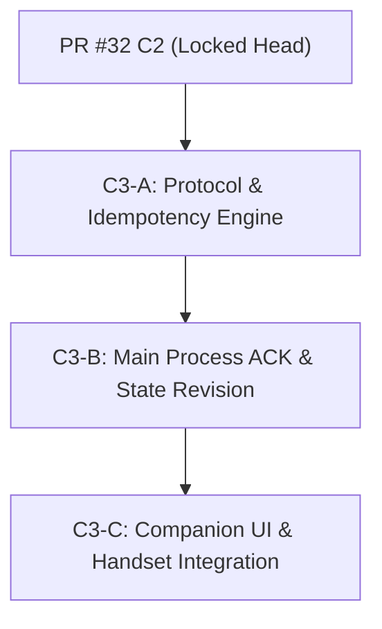

# Companion V2 C3 — Request IDs, Authoritative Acknowledgements, and Idempotency Audit & Plan

**Repository:** `C:\Users\KickA\Desktop\Lights Out`  
**Base Head:** `ffff1302e6df46fd32f33013405737765b334c85` (Locked PR #32 C2)  
**Branch:** `audit/companion-v2-c3-request-acks`  
**Status:** Architecture Audit & Specification Document (Remediated Specification)

---

## 1. Scope & Purpose

This document provides a comprehensive, remediated architecture audit of the Lights Out companion control plane and defines the exact protocol contract, idempotency semantics, acknowledgement lifecycle, and UI state machine for **Companion V2 C3 (Request IDs, Authoritative Acknowledgements, and Idempotency)**.

The primary objective of C3 is to elevate companion remote control from indirect state-polling locks to **authoritative server-side deduplication and targeted command acknowledgements**.

---

## 2. Current Command Path Audit

### End-to-End Command Trace

Every companion interaction currently follows this workflow:

```text
User Physical Gesture (Tap / Key)
  │
  ▼
companion.html UI Handler (validates local stateIsAuthoritative())
  │
  ▼
ws.send(JSON.stringify({ action: ... }))  [Client WebSocket]
  │
  ▼
TCP Transport (LAN Wi-Fi)
  │
  ▼
companion.js consumeFrames()  [RFC 6455 Frame Reader & Unmasking]
  │
  ▼
remoteControl.validateCompanionMessage()  [Action & Range Sanitization]
  │
  ▼
companion.js EventEmitter ('message' event)
  │
  ▼
main.js handleCompanionMessage()  [Main Process Handler]
  │
  ▼
startTimer() / pauseTimer() / resumeTimer() / cancelTimer()  [State Mutation]
  │
  ▼
broadcastCompanionState()  [Desktop State Broadcast (type: 'state')]
  │
  ▼
companion.html handleUpdate() / confirmPendingFromState()  [Client State Match]
```

### Supported Companion Messages & Classification

| Action / Message | Category | Description / Parameters | Current Desktop Effect |
| :--- | :--- | :--- | :--- |
| `getNightModes` | Read-Only Query | `{ action: 'getNightModes' }` | Returns `type: 'nightModes'` with catalogue modes. |
| `start` | Mutating Command | `{ action: 'start', durationSeconds, timerAction }` | Starts standard timer with specified duration and action. |
| `startNightMode` | Mutating Command | `{ action: 'startNightMode', nightModeId }` | Resolves canonical mode in main process and starts timer. |
| `pause` (was `togglePause`) | Mutating Command | `{ action: 'pause' }` | Explicitly pauses active timer (idempotent). |
| `resume` (was `togglePause`) | Mutating Command | `{ action: 'resume' }` | Explicitly resumes paused timer (idempotent). |
| `snooze` | Mutating Command | `{ action: 'snooze', seconds }` | Adds seconds to active timer. |
| `cancel` | Mutating Command | `{ action: 'cancel' }` | Stops active timer/ritual back to IDLE. |
| `type: 'state'` | Server-to-Client | Broadcast from main process | Delivers full companion projection update. |
| `type: 'nightModes'` | Server-to-Client | Targeted response from main process | Delivers Night Mode catalogue array. |
| Local UI Toggles | Local UI-Only | Accordion, modal open/close, action segment | Updates DOM view state without WS transmission. |

### Duplicate Execution Vulnerabilities in Current Codebase

1. **Non-Idempotent `togglePause` Flaws:** Currently, the companion uses `togglePause`. If a network retry occurs or user double-taps, sending `togglePause` twice pauses then immediately resumes the timer! C3 replaces `togglePause` with explicit, idempotent `pause` and `resume` commands.
2. **Network Retries & Packet Duplication:** If a TCP retransmission, Wi-Fi packet duplicate, or client browser retry occurs during network jitter, the desktop server receives multiple identical JSON frames. `handleCompanionMessage()` processes every valid frame independently:
   - Duplicate `snooze(900)` frames increase timer by $+1800\text{s}$ ($+30\text{m}$) instead of $+15\text{m}$.
   - Rapid double-taps on preset start buttons dispatch duplicate start requests before UI state updates.
3. **Client-Side Pending Locks vs. Server Idempotency:** C1 introduced `pendingOperation` in `companion.html` to disable buttons while waiting for a matching state broadcast. However, client-side UI locking:
   - Cannot prevent rapid gestures occurring within the same event loop frame.
   - Provides zero protection against network-level frame replays or proxy duplicates.
   - Provides zero protection across multiple paired devices tapping concurrently.
   - The desktop main process currently retains **no record of past commands** and executes all incoming frames blindly.

---

## 3. Request-ID Contract Specification

### Additive Schema & Protocol V3

C3 introduces protocol version `v3` and a mandatory `requestId` property for all mutating companion commands.

#### Example Mutating Command (Protocol V3):
```json
{
  "v": 3,
  "action": "snooze",
  "requestId": "9b1deb4d-3b7d-414d-9076-24a919379899",
  "seconds": 900
}
```

### Request-ID Constraints & Sanitization
- **Allowed Character Set:** Alphanumeric characters `[a-zA-Z0-9]`, hyphen `-`, and underscore `_`.
- **Length Bounds:** Minimum 16 characters, maximum 64 characters.
- **Format Validation Regex:** `/^[a-zA-Z0-9_-]{16,64}$/`
- **Validation Function:** Integrated directly into `remoteControl.validateCompanionMessage()`.
- **Malformed Handling:** Any mutating command with a missing, non-string, or invalid `requestId` is rejected with `invalid_request_id`.

### Generation Mechanism
Client generation uses standard UUID v4:
```javascript
function generateRequestId() {
  if (typeof crypto !== 'undefined' && typeof crypto.randomUUID === 'function') {
    return crypto.randomUUID();
  }
  // Fallback for older WebView contexts
  const bytes = new Uint8Array(16);
  crypto.getRandomValues(bytes);
  bytes[6] = (bytes[6] & 0x0f) | 0x40; // Version 4
  bytes[8] = (bytes[8] & 0x3f) | 0x80; // Variant 10xx
  const hex = Array.from(bytes, b => b.toString(16).padStart(2, '0')).join('');
  return `${hex.slice(0,8)}-${hex.slice(8,12)}-${hex.slice(12,16)}-${hex.slice(16,20)}-${hex.slice(20)}`;
}
```

### Query Correlation IDs vs. Mutating Request IDs
- **Mutating Commands:** `requestId` is mandatory (`start`, `startNightMode`, `pause`, `resume`, `snooze`, `cancel`).
- **Read-Only Queries:** `getNightModes` uses an optional `correlationId` field (e.g. `{ action: 'getNightModes', correlationId: 'q-98765' }`). The server echoes `correlationId` in `type: 'nightModes'`. Read query correlation IDs are NOT stored in the mutating idempotency registry, preventing registry pollution.

---

## 4. Acknowledgement Semantics

### Targeted `commandAck` Protocol Frame

Instead of relying on indirect timer state broadcasts to resolve pending UI states, the server immediately emits a targeted `commandAck` frame to the specific client socket that submitted the request.

```json
{
  "type": "commandAck",
  "requestId": "9b1deb4d-3b7d-414d-9076-24a919379899",
  "action": "snooze",
  "status": "applied",
  "duplicate": false,
  "reason": null,
  "stateRevision": 42
}
```

### Status & Duplicate Modeling Rules

1. **`status` Values:** The `status` field in `commandAck` is strictly bounded to `'applied'` or `'rejected'`.
2. **`duplicate` Flag:** `duplicate` is modeled as a **boolean flag** (`"duplicate": true | false`), NOT a separate status enum. Deduplicated re-transmissions return `status: 'applied'` (or `'rejected'`) with `"duplicate": true`.
3. **Targeted ACK Resolution Only:** The phone UI resolves its pending state **exclusively** upon receiving a targeted `commandAck` matching its active `requestId`. Generic `type: 'state'` broadcasts update UI display values but NEVER clear command pending locks.

| Status | `duplicate` Flag | Meaning | Client UI Behavior |
| :--- | :--- | :--- | :--- |
| `applied` | `false` | First-time execution succeeded. Desktop state updated. | Resolves `pending` to success, shows toast, unlocks UI. |
| `applied` | `true` | Request was previously executed successfully. Returned cached result. | Resolves `pending` without re-running action, unlocks UI. |
| `rejected` | `false` | Policy or validation blocked execution. Contains `reason`. | Resolves `pending` to error, shows specific reason, unlocks UI. |
| `rejected` | `true` | Request was previously rejected. Returned cached rejection result. | Resolves `pending` to error, shows specific reason, unlocks UI. |

---

## 5. Stable Rejection Reason Enum

To prevent leaking desktop paths, stack traces, or internal object structures, C3 defines a strict, bounded enum of machine-readable error codes:

```javascript
const REJECTION_REASONS = {
  INVALID_REQUEST_ID: 'invalid_request_id',
  REQUEST_ID_CONFLICT: 'request_id_conflict',
  INVALID_PAYLOAD: 'invalid_payload',
  UNSUPPORTED_ACTION: 'unsupported_action',
  NOT_AUTHENTICATED: 'not_authenticated',
  NOT_IDLE: 'not_idle',
  NO_ACTIVE_TIMER: 'no_active_timer',
  ALREADY_PAUSED: 'already_paused',
  ALREADY_RUNNING: 'already_running',
  MODE_UNKNOWN: 'mode_unknown',
  MODE_UNAVAILABLE: 'mode_unavailable',
  RITUAL_ACTIVE: 'ritual_active',
  STALE_STATE: 'stale_state',
  REGISTRY_FULL: 'registry_full',
  PROTOCOL_VERSION_MISMATCH: 'protocol_version_mismatch',
  INTERNAL_ERROR: 'internal_error'
};
```

---

## 6. Server-Side Idempotency Engine

### In-Memory Registry Architecture

The desktop main process maintains an in-memory idempotency registry:

```javascript
// Map<string, IdempotencyRecord>
// Key format: `${clientTokenHash}:${requestId}`
```

#### Record Schema:
```javascript
{
  requestId: '9b1deb4d-3b7d-414d-9076-24a919379899',
  action: 'snooze',
  payloadHash: 'a591a6d40bf420404a011733cfb7b190d62c65bf0bcda32b57b277d9ad9f146e',
  status: 'applied', // 'in_progress' | 'applied' | 'rejected'
  promise: Promise<IdempotencyRecord> | null, // Active execution promise during in_progress
  terminalAck: { ... }, // Cached commandAck DTO
  createdAt: 1784343000000,
  expiresAt: 1784343600000
}
```

### Rules & Edge Behavior

1. **In-Progress Identical Duplicates (Promise Awaiting):**
   - If an identical duplicate arrives while the initial request is still `in_progress`, the server attaches to the pending `promise` of the initial request.
   - When processing completes, the server sends the exact same terminal `commandAck` with `"duplicate": true` to the second socket.
   - In-progress identical duplicates are **NEVER dropped, rejected as conflicts, or re-executed**.
2. **Same `requestId`, Same Payload Hash (Completed):**
   - Server returns cached `terminalAck` with `"duplicate": true`.
   - Desktop timer/ritual state is NOT mutated again.
3. **Same `requestId`, Different Action or Payload Hash:**
   - Server rejects request with `status: 'rejected'`, `reason: 'request_id_conflict'`.
   - Neither the original nor the new command is executed.
4. **Capacity Bounds & Eviction Policy (Evict Expired Only):**
   - **Max Capacity:** Capped at 1,000 entries.
   - **TTL:** 10 minutes (600,000 ms).
   - **Eviction Rule:** LRU eviction **MUST NEVER evict unexpired records**. If registry reaches capacity (1,000 active items) and ALL records are unexpired, new distinct requests are rejected with `reason: 'registry_full'`. This guarantees unexpired deduplication keys are never evicted prematurely, preventing replay vulnerabilities.
   - **Cleanup:** Periodic sweep timer every 60 seconds purges expired entries (`Date.now() > record.expiresAt`).
5. **Server Restart:**
   - Registry is in-memory only (never persisted to settings or disk).
   - On desktop restart, registry is empty. Client connection loss clears client pending state, ensuring no accidental command replay across desktop restarts.

---

## 7. Authoritative State Correlation & Projection Revision

### Full Companion Projection Revision Counter (`stateRevision`)

- Desktop `timerState` adds a monotonically increasing integer property: `stateRevision`.
- Incremented on every mutation across the **complete companion projection**, including:
  - Timer state (`running`, `paused`, `remainingSeconds`, `totalSeconds`, `action`, `phase`)
  - Night Mode state (`nightModeId`, `nightModeTitle`, `nightModeVersion`)
  - Ritual state (`ritualId`, `active`, `step`)
  - Profile state (`profileId`, `profileName`)
  - System info & settings (`powerPlan`, `battery`, remote control mode)
- Broadcast in `type: 'state'` messages to all connected companion clients.
- Included in targeted `commandAck` frames for applied actions.

### Privacy & Multi-Client Isolation Rules
- `stateRevision` is broadcast globally to all connected phones.
- `requestId` is **strictly targeted** — returned ONLY in the direct `commandAck` to the requesting socket. Other connected companion clients receive state updates via `type: 'state'` broadcasts but never inspect another device's `requestId`.

### Definition of Applied Terminal State
- `snooze`: `applied` when `remainingSeconds` increases by requested duration.
- `pause`: `applied` when `timerState.paused === true` (retrying when already paused returns `applied` with current state).
- `resume`: `applied` when `timerState.paused === false` && `timerState.running === true` (retrying when already running returns `applied` with current state).
- `cancel`: `applied` when `timerState.running === false` && `timerState.paused === false`.
- `startNightMode` / `start`: `applied` when timer or ritual gateway becomes authoritatively active (`running === true` or `ritualMode.getState().active === true`).

---

## 8. Reconnect Behavior & Safety

### Preservation of C1 No-Replay Rule
- Disconnect or connection loss immediately discards client pending UI (`discardPendingForConnectionLoss()`).
- Reconnecting socket NEVER re-sends unacknowledged commands.
- Late `commandAck` messages from an obsolete socket generation are ignored by the client (`generation !== socketGeneration`).
- Re-established connections request a fresh state and catalogue, using server `type: 'state'` broadcasts as the sole source of truth.

### Network Replay Immunity
If a network layer or proxy re-transmits an un-ACKed WS frame during reconnect within the 10-minute TTL window, the server idempotency engine catches the duplicate `requestId` and returns the cached `commandAck` without re-executing the action.

---

## 9. Client UI State Machine & Gesture Guarding

### State Flow

```text
[ IDLE ]
   │
   │  User Action (Gesture / Button Tap)
   ▼
[ PENDING ] ── (Generates unique requestId, disables UI mutation controls, sets 5s timeout)
   │
   ├──────► Received matching targeted commandAck (status: 'applied') ──► [ APPLIED ] ─► Toast + Unlock UI
   ├──────► Received matching targeted commandAck (status: 'rejected') ─► [ REJECTED ] ─► Error + Unlock UI
   └──────► Timeout (5000ms elapsed without ACK) ────────────────────────► [ TIMEOUT ] ──► Error + Unlock UI
```

### Physical Gesture Convergence
To guarantee that one physical user gesture produces exactly ONE `requestId` and ONE frame:
- Pointer taps, touch events, click handlers, and keyboard presses (`Enter` / `Space`) MUST all route through a single internal dispatcher: `dispatchMutatingCommand(action, payload)`.
- If `pendingOperation` is active or state is non-authoritative, `dispatchMutatingCommand` immediately drops subsequent inputs before generating a request ID or touching the WebSocket.

---

## 10. Security Audit & Non-Bypass Guarantees

1. **No Canonical Resolution Bypass:** `startNightMode` transmits ONLY `nightModeId` and `requestId`. Desktop main process resolves action, duration, ritual, and title authoritatively.
2. **No Unforgeable Property Smuggling:** Client cannot pass `startOrigin`, `dryRun`, `forceShutdown`, or ritual overrides. Server sanitizes all inputs in `validateCompanionMessage()`.
3. **No Secret Extraction:** `commandAck` DTO contains only `requestId`, `action`, `status`, `duplicate`, `reason`, and `stateRevision`. Zero tokens, file paths, or internal objects are returned.
4. **Request IDs Are Deduplication Identifiers, Not Credentials:** Token authentication (`t` parameter during WebSocket upgrade) remains mandatory. Unauthenticated connections are rejected before frame parsing occurs.

---

## 11. Protocol V3 Compatibility & Android Runtime Strategy

### Protocol Compatibility & Legacy PWA Strategy
- Protocol version is `v3`.
- Incoming mutating frames include `"v": 3` and `requestId`.
- **Stale / Legacy Client Handling:** If a stale cached PWA page sends a mutating action without `requestId`, the desktop server rejects the command with `reason: 'protocol_version_mismatch'` and emits a targeted `type: 'upgradeRequired'` frame.
- **PWA Atomic Upgrade:** Because `companion.html` is served directly by the Electron main process over LAN HTTP (`http://<ip>:58732/`), refreshing the companion PWA fetches the updated `v3` PWA asset atomically.

### Android Runtime Compatibility Verification (`companion-android`)
- **App Architecture:** `companion-android` is a thin Kotlin WebView wrapper around `companion.html` with a CameraX + ML Kit QR scanner for token parsing.
- **WebView Compatibility:** Modern Android System WebView (Chromium engine on Android 7.0+ / Android 16) natively supports Web Crypto API (`crypto.randomUUID()` and `crypto.getRandomValues()`).
- **Zero Native APK Re-compilation Required:** Because `companion-android` loads `companion.html` dynamically from the desktop app endpoint over Wi-Fi, updating `companion.html` in `electron/` automatically upgrades the Android app UI without modifying Kotlin source or re-building the APK.

---

## 12. Verification & Testing Strategy

### Unit Suite (`test/companion-idempotency.test.js`)
- `requestId` validation (regex, length, missing/malformed rejection).
- Idempotency engine deduplication (same ID + same payload returns cached ACK with `duplicate: true`).
- In-progress identical duplicates await pending execution promise and return exact ACK.
- Same ID + different payload returns `request_id_conflict`.
- Memory bounds & TTL eviction tests (unexpired records preserved).
- `pause` and `resume` explicit idempotency checks.

### Protocol Suite (`test/companion-frames-c3.test.js`)
- RFC 6455 masked WebSocket frame handling with `requestId` and `v: 3`.
- Targeted `commandAck` delivery to requesting socket.
- Handling missing/malformed `requestId` on mutating frames.

### Electron Smoke & Integration (`scripts/companion-v3-electron-proof.js`)
- Main-process duplicate command handling for `startNightMode`, `snooze`, `pause`, `resume`, `cancel`.
- Runtime proof that duplicate requests return cached results without double execution or real power actions.

---

## 13. PR Implementation Sequence



1. **C3-A — Protocol Primitives & Idempotency Engine:**
   - Extend `remoteControl.validateCompanionMessage()` for `requestId` and `v: 3`.
   - Replace `togglePause` in `remoteControl.js` with explicit `pause` and `resume`.
   - Build `idempotencyRegistry.js` (in-memory deduplication store with promise awaiting & unexpired capacity protection).
   - Add unit tests in `test/companion-idempotency.test.js`.
2. **C3-B — Main Process Lifecycle & Targeted ACK:**
   - Integrate `commandAck` frame dispatch in `companion.js` and `main.js`.
   - Add `stateRevision` tracking to complete companion projection.
   - Update Electron runtime proof suite.
3. **C3-C — Companion UI Integration & Real Handset Proof:**
   - Update `companion.html` to generate `requestId` via `crypto.randomUUID()` and send explicit `pause`/`resume`.
   - Wire targeted `commandAck` listener as exclusive pending resolution.
   - Execute handset proof on Samsung S23 over Wi-Fi.

---

## 14. Open Design Questions & Tuning

1. **Client Timeout Duration:** What is the optimal timeout for slow LAN Wi-Fi before the client marks a pending request as unconfirmed? (Recommended: 5000ms fallback, configurable up to 8000ms under high latency).
2. **Custom Snooze Steps:** Should `snooze` allow custom second values or be restricted strictly to discrete standard steps (`300`, `900`, `1800`)? (Audit recommends keeping bounded range 60–3600 seconds with preset buttons sending standard values).
3. **Cancellation ACK Timing:** Should `commandAck` for a `cancel` command return immediate `applied` status upon timer state reset, or wait for background process/media pause cleanup? (Audit recommends returning `applied` immediately when `timerState` becomes IDLE).
