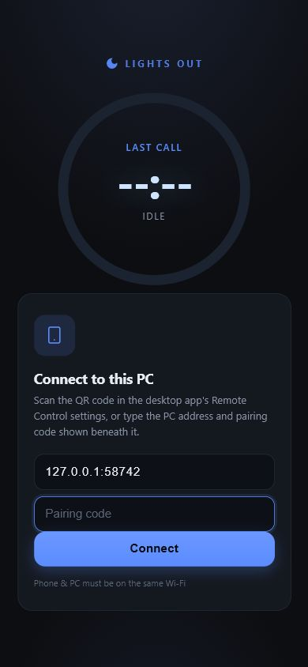
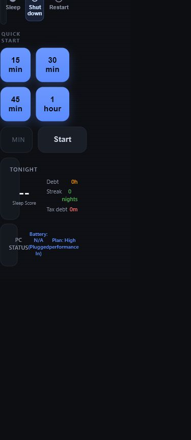
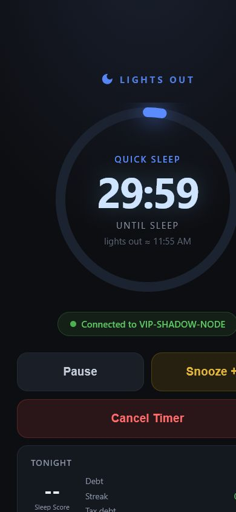
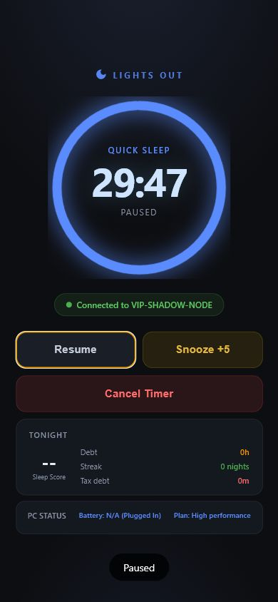
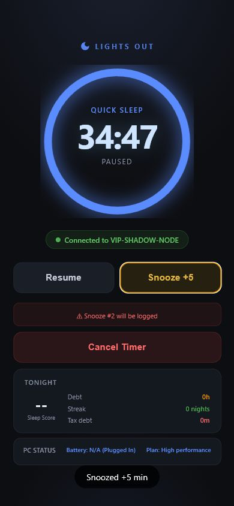
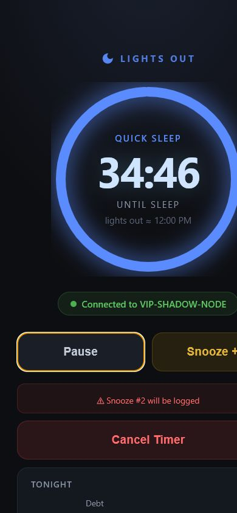
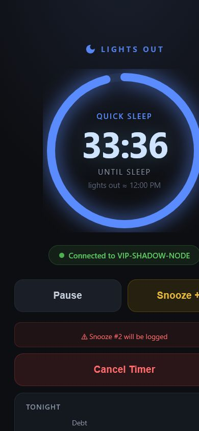
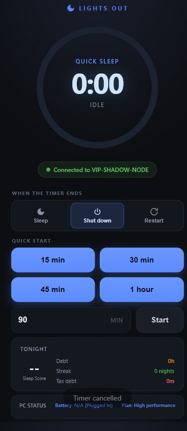
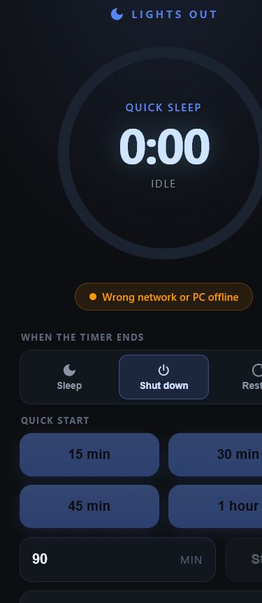
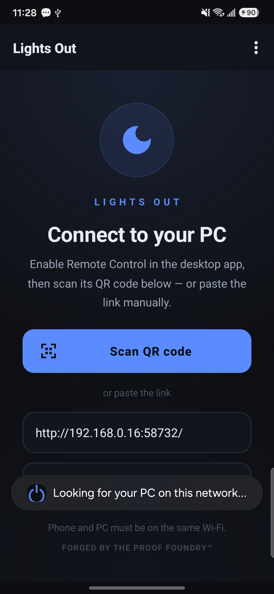

# Lights Out Companion V2 Audit and PR Plan

Date: 2026-07-16
Release baseline: `v11.1.0`, frozen
Repository baseline: clean `main` at `adbe2e16b15b7d298076c3b9e81f48ce1d2bd89b`

## Scope and proof boundary

This is a read-only product/UX audit. No Electron, Android, protocol, release, or packaged-build source was changed. The only repository additions are this report and its screenshots.

The web companion was exercised at a 390 x 844 phone viewport against an isolated real Electron main process, the shipped companion HTTP/WebSocket server, and the authoritative desktop timer. The desktop started a 30-minute Quick Sleep timer in Dry Run; the phone controlled that live timer. No Windows power action was possible or attempted.

An attached Samsung SM-S911W also ran the installed Android wrapper (`com.lightsout.companion`, version 1.0 / code 1). Its current native setup screen was captured. A full real-phone LAN pairing pass was not completed because an unrelated Python preview server already owned the product's fixed port `58732`; that user process was deliberately left untouched. Therefore, this report does not claim packaged-desktop-plus-real-phone proof.

## Current flow capture

1. Pairing shell: clear title, host, pairing-code field, same-Wi-Fi note.
   
2. Connected idle: PC identity and timer-start controls appear after the token-authenticated WebSocket opens.
   
3. Active authoritative timer: countdown and phase update from desktop broadcasts.
   
4. Pause: confirmation appears; the authoritative state changes to Paused.
   
5. Add time: one confirmed `+5` changed `29:47` to `34:47` exactly once.
   
6. Resume: the authoritative countdown resumed and continued decrementing.
   
7. Reconnect: after the original page was lost, a fresh page reused the stored token and restored the live desktop state (`34:32` before loss, `33:39` after reconnect).
   
8. Cancel: a confirmed cancel returned the authoritative timer to idle.
   
9. PC unavailable: the page changes to “Wrong network or PC offline,” disables start controls, and retries every three seconds.
   
10. Native Android entry screen: QR is prominent and manual URL remains available.
    

## What is already reliable

| Capability | Evidence | Assessment |
| --- | --- | --- |
| Token-gated WebSocket | Valid token connected; missing/bad-token and frame validation are covered by tests | Reliable foundation; preserve |
| Desktop authority | Phone reflected desktop ticks, pause, add-time, resume, cancel, and reconnect state | Reliable foundation; preserve |
| Live countdown | Updates arrived every two seconds and continued after reconnect | Reliable, slightly coarse |
| Pause/resume | Both transitions worked through the current `togglePause` command | Works, but the command is non-idempotent |
| Add `+5` | Paused value moved exactly `+300s` once | Reliable for the tested path |
| Cancel | Confirmation plus authoritative idle state | Reliable, copy/feedback need work |
| Reload/reconnect | Stored token reconnected and current desktop state won | Reliable for page loss/reload |
| Offline gating | Start controls disabled when the server disappeared | Reliable basic safety behavior |
| Protocol bounds | 23/23 isolated protocol/integration tests passed | Reliable |

## Ruthless UX audit

### Information hierarchy

The circular countdown is visually dominant and strong. Everything below it is less disciplined. “Tonight” stats, override-tax copy, battery, and power-plan details compete with the three controls needed in bed. The active screen should be countdown, mode/PC/safety state, add time, pause/resume, stop—in that order. Stats and diagnostics should move behind a secondary disclosure.

The idle screen is a second product surface (remote timer creation) mixed into the controller. It defaults to **Shut down**, which is too aggressive for a bedside surface and distracts from PR C1. C1 should not expand or redesign remote start; it should prioritize controlling an already-running desktop timer.

### One-handed usability, size, and spacing

Primary buttons are generally tall enough, but the two-column active row is fragile. At 390 px, the flex items can keep oversized minimum widths while `overflow-x: hidden` clips the right-hand `Snooze +5` control. The same problem is visible in reconnect/offline captures. Controls need `min-width: 0`, a phone-safe grid, and a single-column fallback for narrow/large-font conditions.

Pause/resume and add-time sit side by side with similar weight even though add time is the more common low-risk action. Stop is full-width and separated, which is correct.

### Countdown readability and dark-room behavior

The 56 px tabular countdown is readable, and the ring gives useful phase context. The mode label, “until action,” target time, PC status, tax text, and diagnostics are 9–12 px with low-contrast muted colors. Those are too small for sleepy, arm's-length use. The UI has no bedside dimmer, extra-dark theme, OLED-black option, or explicit brightness guidance. The glowing ring is attractive but can be too bright in a dark room.

### Connection and target-PC clarity

The green connected pill and PC hostname are clear. Offline and expired-pairing states are differentiated in code. Missing pieces: last-updated age, retry countdown/action, stale-state marker, and a clear distinction between “page connected” and “desktop timer state recently received.” Offline mode leaves stale timer/stats/system information visible, which can look current.

The Android setup screen relies on an IP/URL or QR. UDP auto-discovery is explicitly best-effort and may never appear on isolated Wi-Fi. When auto-detect is absent, the target PC name is not visible until after connection.

### Destructive actions and feedback

“Emergency cancel the timer?” is melodramatic and does not name the Night Mode, PC, remaining time, or consequence. Native `confirm()` dialogs are visually disconnected from the product. Pause and add-time also require confirmation, adding unnecessary friction to reversible actions.

The page shows success toasts immediately after `send()`, before any desktop acknowledgement or authoritative state echo. A dropped connection can therefore say “Timer cancelled” even when nothing changed.

### Add-time controls

Only `+5` exists. The requested `+15` and `+30` can use the existing validated `snooze` command with 900 and 1800 seconds; no protocol rewrite is needed. Current override-tax messaging becomes prominent after a snooze but is hard to understand at bedside scale.

### Reconnect and recovery

The page retains host/token, retries three seconds after socket failure, distinguishes expired pairing with `/pair-check`, and recovered the authoritative state after a page loss. There is no `visibilitychange`, `pageshow`, `online`, or Android `onResume` WebView refresh hook, so background/foreground recovery depends on the browser/WebView retaining or eventually closing its socket. Killed-app recovery depends on the native saved URL plus page localStorage/native token mirroring and is not guaranteed if storage is cleared.

The Android wrapper adds an 8-second main-frame timeout, a 20-second subnet-scan cooldown, and a 30-second failed-host cooldown. Those limits are sensible but invisible to the user.

### Night Modes, Dry Run, profiles, and receipts

The desktop timer owns canonical `nightModeId`, title, version, profile identity, Dry Run, and receipts. The companion state currently broadcasts `dryRun` but does not render it. It does not broadcast/render Night Mode identity or profile identity, and it has no receipt surface.

The idle phone start command does not carry Dry Run, Night Mode, or profile identity; main starts it with default non-Dry-Run behavior. This is why the audit started Dry Run on desktop and used the phone only as a controller. Do not claim the current phone can safely choose Dry Run.

### Pairing, diagnostics, and security

Good foundations: remote control is off by default, every socket is token-gated, comparison is constant-time, host overrides cannot exfiltrate a token from an HTTP-served page, messages are allow-listed/bounded, and remote force shutdown/logout/hibernate are impossible.

Gaps: no user-visible token age/rotation status, no connection diagnostics view, no last successful state timestamp, no command acknowledgement, no request IDs, and no stale-session indicator. LAN traffic remains plaintext by accepted product design; the pairing token is therefore the control boundary and should continue to be treated as a secret.

## Defects versus feature ideas

### Defects / reliability gaps

1. **P0 for C1:** active controls can clip at a normal 390 px phone width.
2. **P0 for C1:** success toasts are optimistic; commands have no acknowledgement or authoritative pending state.
3. **P0 for C1:** Dry Run is broadcast but not displayed; a phone-started timer does not inherit desktop Dry Run.
4. **P1:** `togglePause` is non-idempotent and has no duplicate-command key.
5. **P1:** offline state can present stale timer/stats/system information without a stale marker.
6. **P1:** no explicit foreground/background resume hook.
7. **P2 test fragility:** `smoke:companion` assumes fixed port `58732`; with an unrelated listener it produced 1 pass / 14 failures, while the 23 port-isolated tests passed.

### Feature ideas

1. `+15` and `+30` bedside controls.
2. Night Mode title and profile identity.
3. Dedicated receipt/history presentation.
4. Bedside dimmer / OLED-black mode.
5. Pairing diagnostics and retry details.
6. Night Mode selection/start (PR C2).

## PR C1 — Bedside Timer Controller

### Narrow product contract

C1 changes only the active-timer phone experience and additive state projection. It keeps the current HTTP/WebSocket transport, token, action names, desktop timer engine, and desktop authority. No pairing redesign, Night Mode start, router/smart-home control, receipt browser, account, cloud, or Android signing work.

### Implementation plan

1. **State projection (`electron/main.js`)**
   - Add `nightModeId`, `nightModeTitle`, `profileId`, and `profileName` to the existing outbound state message.
   - Continue sending `pcName`, `dryRun`, running/paused, remaining/total, action, and phase.
   - Do not accept these identities back from generic timer-control commands.

2. **Bedside layout (`electron/companion.html`)**
   - Active hierarchy: Night Mode/title → dominant countdown → Dry Run/real-action badge → connected PC and freshness → `+5/+15/+30` → Pause/Resume → Stop Tonight's Run.
   - Move stats, tax detail, battery, and power plan behind a compact “Details” disclosure.
   - Make controls at least 48 px tall, remove horizontal clipping, support 320–430 px and large-font conditions, and add a reduced-glow/extra-dark presentation.
   - Replace native confirmation for cancel with an in-page confirmation naming the run and PC. Remove confirmation from reversible pause/resume/add-time.

3. **Single-send pending guard (`electron/companion.html`)**
   - On tap, send once, disable the affected controls, show “Waiting for PC…,” and clear only after an authoritative state change or timeout.
   - Do not show success before the state echo.
   - Do not retry commands automatically. WebSocket reconnect only restores state.
   - Keep `togglePause` for C1 transport compatibility; schedule explicit idempotent pause/resume plus request IDs/acks for C3.

4. **Add-time controls**
   - Send the existing `{ action: 'snooze', seconds }` message with 300, 900, or 1800.
   - Verify each button produces one inbound message and one authoritative duration increase.

5. **Regression proof**
   - Extend source smoke for labels, fields, safe defaults, pending guards, and no unsupported controls.
   - Add an isolated live companion harness on an ephemeral port; do not depend on `58732` being free.
   - Exercise the real main process/timer plus a phone viewport. Keep every proof timer in Dry Run and cancel it.

### C1 acceptance matrix

| Required proof | Pass condition |
| --- | --- |
| Active countdown updates live | Two successive authoritative ticks decrement without client-side invention |
| `+5`, `+15`, `+30` exact once | Each creates one message and increases remaining time by exactly 300/900/1800 seconds |
| Pause/resume | State changes authoritatively; pending UI clears only on echo |
| Cancel | In-page confirmation, one send, authoritative idle state, cancelled receipt on desktop |
| Reconnect preserves state | Page loss/foreground recovery returns to the current desktop state and never replays a command |
| Desktop remains authoritative | Reloaded phone cannot overwrite remaining time, phase, identity, profile, or Dry Run |
| No duplicate commands | Rapid double tap and reconnect produce one inbound command; no automatic command retry |
| No nightly regression | Existing desktop timer/runtime proofs and full unit/smoke suites remain green |
| Phone layout | 320, 360, 390, 412, and 430 px widths; no clipping or hidden primary control |
| Safety | Remote force shutdown/logout/hibernate remain impossible; idle startup remains inert |

## Sequencing recommendation

1. Implement and prove C1 as above.
2. Run several real nights with C1 before C2.
3. C2 may add canonical Night Mode start only after C1 is stable.
4. C3 owns explicit command IDs/acknowledgements, idempotent pause/resume, stale-session policy, foreground/background recovery, token lifecycle, and packaged-desktop-plus-real-phone proof.

## Verification record

- Git baseline: clean `main`, `adbe2e16b15b7d298076c3b9e81f48ce1d2bd89b` before audit artifacts.
- Live isolated companion flow: pairing, connected idle, live countdown, pause, exact-once `+5`, resume, page-loss reconnect, cancel, offline state.
- Real power actions: 0.
- Port-isolated companion protocol/integration tests: 23/23 passed.
- Fixed-port `npm run smoke:companion`: 1/15 passed because an existing Python process owned `127.0.0.1:58732`; not evidence of a protocol regression.
- Real Android device: app cold-launched and native setup captured; no camera permission granted and no signing material touched.
